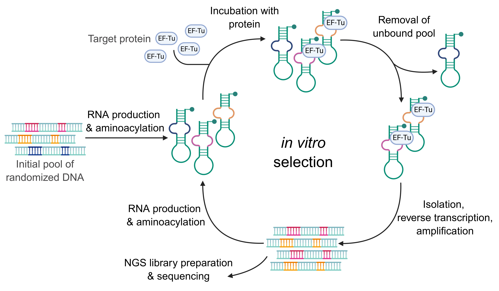
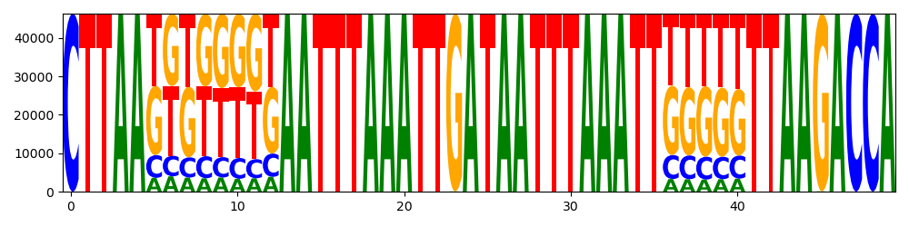

# Recognition of aberrant mt-tRNA structures by EF-Tu

## Project description

Experiments with *in vitro* molecule selection by proteins can demonstrate 
the optimal tRNA structure accepted by protein. 

Test protein in this case: EF-Tu (from *R. culicivorax*), which can accept 
truncated tRNAs. 
Test molecule: mt-tRNA-Ile.

The experiment layout and library preparation steps (designed by Nadine Grafl):



## Data analysis steps

Analysis consists of several parts: 

1. Check library statistics, quality control
2. Prepare target sequences
3. Folding with following analysis

Before enrichment analysis, initial randomized pool were checked. 
Bias towards G and T bases was found, as a characteristic of molecules production.



### Pipeline

#### Requirements

What was used: 
- snakemake 7.32.4
- python 3.10.16
- biopython 1.79
- RNAplfold/RNAfold 2.4.9
- R 4.4.1, RStudio

R packages:
- ggplot2 3.5.2
- dplyr 1.1.4
- tidyr 1.3.1
- DiffLogo 2.28.0

#### Preprocessing

Reads trimming (in `reads_preprocessing`):

`snakemake --cores N --config input_dir="path/to/input" output_dir="path/to/output`

Collect run statistics

```
python scripts/statistics_collection/run_statistics.py

usage: run_statistics.py [-h] -i_raw INPUT_RAW -i_tr INPUT_TRIMMED -o OUTPUT

optional arguments:
  -h, --help            show this help message and exit
  -i_raw INPUT_RAW, --input_raw INPUT_RAW
                        Path to raw reads in fastq.gz format
  -i_tr INPUT_TRIMMED, --input_trimmed INPUT_TRIMMED
                        Path to reads in fastq.gz format (all stages)
  -o OUTPUT, --output OUTPUT
                        Path to collected stats
```

Read length distribution:

```
python scripts/statistics_collection/length_distribution_per_sample.py

usage: length_distribution_per_sample.py [-h] -i INPUT -o OUTPUT

optional arguments:
  -h, --help            show this help message and exit
  -i INPUT, --input INPUT
                        Path to reads in fastq.gz format (fully processed
                        T7_HH_HDV)
  -o OUTPUT, --output OUTPUT
                        Path to collected read length distribution
```

Script for length distribution plot: `scripts/statistics_collection/len_plots.R`

#### Prepare targets for folding

On this step two different files with targets are made: targets with length 50 and 51.
As we know that they can be analyzed together, and first base added unspecifically - two files can be simply unified with `cat`
(they have the same length 50)

```
python scripts/prepare_for_folding/targets_from_reads.py

usage: targets_from_reads.py [-h] -i INPUT -o OUTPUT [-t TOP]

optional arguments:
  -h, --help            show this help message and exit
  -i INPUT, --input INPUT
                        Input reads in fastq.gz format
  -o OUTPUT, --output OUTPUT
                        Output reads in fasta format (path without the
                        .extension)
  -t TOP, --top TOP     Print top of not unique targets
```

#### Folding

Generating open energies (change probabilities output to their logarithms).
Can be useful to track small changes.

`RNAplfold -O < targets_i50_51.fasta`

Probability of being unpair (additionally counts mean probability of length u): `RNAplfold -u 2 < targets_i50_51.fasta`

Collect folding results:

```
python scripts/folding_analysis/collect_rnaplfold_results.py

usage: collect_rnaplfold_results.py [-h] -i INPUT -o OUTPUT -s SAMPLE -t
                                    {prob,en}

optional arguments:
  -h, --help            show this help message and exit
  -i INPUT, --input INPUT
                        Path to folder with folding results
  -o OUTPUT, --output OUTPUT
                        Path to output
  -s SAMPLE, --sample SAMPLE
                        Sample name
  -t {prob,en}, --type {prob,en}
                        Type of information (probabilities or open energies)
```

 Minimum free energy (MFE) of target structures:

 `RNAfold -p -d2 --noLP < targets_i50_51.fasta > targets_i50_51.rnafold_out`

 Parce MFE results:

```
python scripts/folding_analysis/mfe_results.py

usage: mfe_results.py [-h] -i INPUT -o OUTPUT

optional arguments:
  -h, --help            show this help message and exit
  -i INPUT, --input INPUT
                        Path to RNAfold folding output
  -o OUTPUT, --output OUTPUT
                        Path to collected MFE

```

#### Visualization

There are two steps in data analysis.
Sequence analysis includes logo and diff logo analysis, together with k-mers analysis.

`scripts/folding_analysis/sequence_analysis.R`

Structure analysis includes folding results visualization

`scripts/folding_analysis/structure_analysis.R`


#### Results example


## Author

Julie Ozerova [julie@bioinf.uni-leipzig.de](julie@bioinf.uni-leipzig.de)
